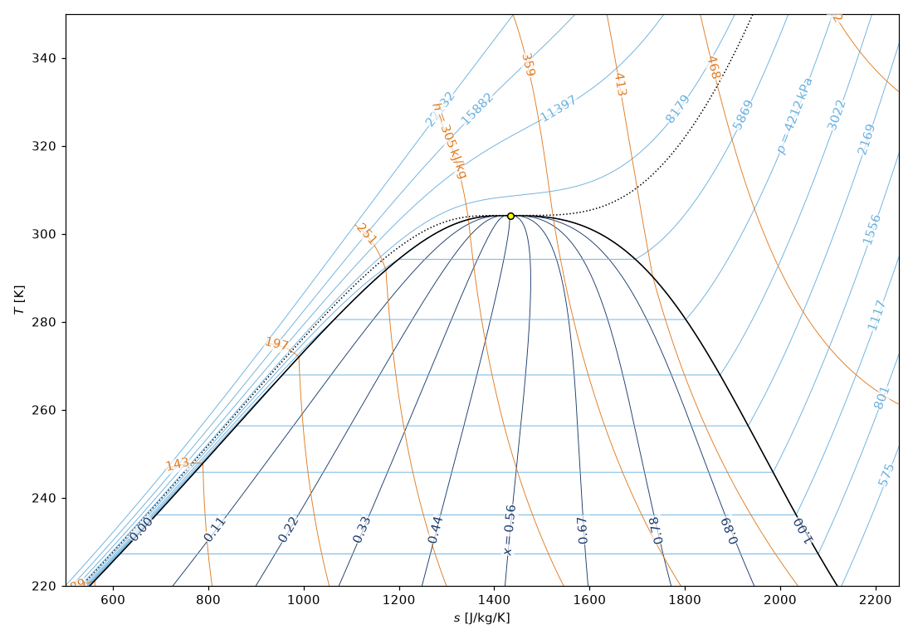

# Thermoplot

Thermoplot draws the background of a temperature–entropy (T–s) or pressure–enthalpy (p–h) diagram for any fluid available in REFPROP, and returns it as a Matplotlib figure on which you can plot your own processes.



## Features

- T–s and p–h diagrams with the saturation dome, the critical point and the critical isoline
- Labelled isolines of vapour quality, pressure and enthalpy (T–s) or temperature and entropy (p–h)
- One INI configuration file per diagram, with settings that can be overridden from Python
- Optional LaTeX typesetting, and a disk cache for diagrams that are drawn repeatedly
- A vectorized `PropsSI`-style wrapper around the CoolProp low-level interface

## Installation

Thermoplot requires Python 3.12 or newer and a REFPROP installation that CoolProp can find.

```bash
git clone https://github.com/mths-mhln/thermoplot.git
cd thermoplot
uv sync
uv run main.py
```

## Usage

```python
import sys
sys.path.insert(0, "src")

import matplotlib.pyplot as plt
from thermoplot import thermoplot

fig = thermoplot("config/CO2.ini")
ax = fig.get_axes()[0]        # plot your own processes on ax
plt.show()
```

## Documentation

The full documentation, with the configuration reference, a user guide and examples, is in the `docs` folder and is published at <https://mths-mhln.github.io/thermoplot/>. To build it locally:

```bash
pip install -r docs/requirements.txt
sphinx-build -b html docs docs/_build/html
```
