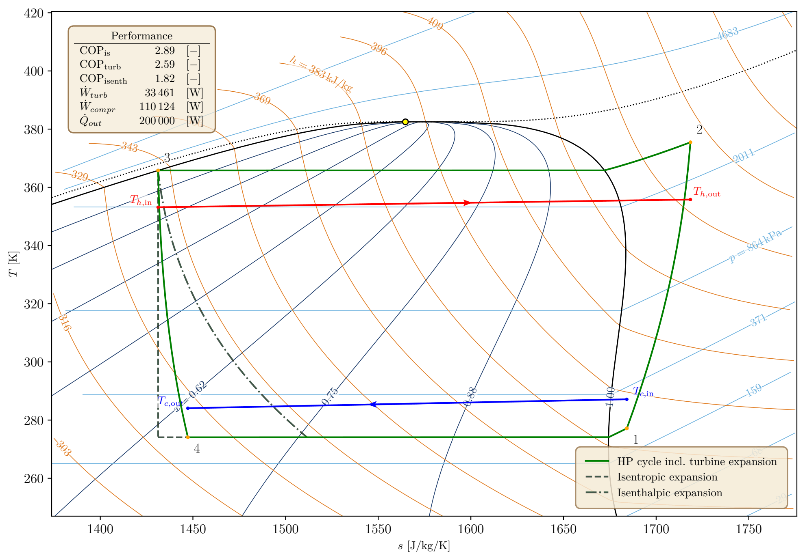

# Thermoplot

Thermoplot is a Python package that automatically produces T-s and p-h diagram figure objects, populated with the thermodynamic information deemed relevant by the user: the saturation dome, the critical point and critical isoline, and isolines of vapour quality, pressure and enthalpy (T-s) or temperature and entropy (p-h). Since the output is a standard matplotlib figure object, it can be customised afterwards, allowing processes of interest to be overlaid on the generated background. The figure below shows a conceptual heat pump cycle of R1234ze(E), whose background T-s diagram was automatically generated and centred around the cycle using thermoplot.



## Dependencies

- Python 3.12 or newer
- CoolProp, matplotlib and numpy. The versions are pinned in `pyproject.toml` and `uv.lock`.
- NIST REFPROP. All thermodynamic properties are extracted from REFPROP through CoolProp, hence a REFPROP licence and installation are necessary.
- A LaTeX installation, only if `latex_formatting = True`.

## How to run

Clone the repository and install the dependencies with [uv](https://docs.astral.sh/uv/):

```bash
git clone https://github.com/mths-mhln/thermoplot.git
cd thermoplot
uv sync
uv run main.py
```

`main.py` plots the T-s diagram of CO2 specified in `config/CO2.ini`, and `uv run examples/heat_pump_cycle.py` plots the figure above. To use Thermoplot in your own script, add the `src` folder to the Python path and pass a config file to `thermoplot`, which returns a matplotlib figure:

```python
import sys
sys.path.append("path/to/thermoplot/src")

import matplotlib.pyplot as plt
from thermoplot import thermoplot

fig = thermoplot(thermoplot_config_file_path="config/CO2.ini")
ax = fig.get_axes()[0]  # plot processes of interest on this axis, in SI units
plt.show()
```

Settings can be overwritten without adapting the config file, e.g. `thermoplot("config/CO2.ini", {"T_range": [250, 320]})`.

## Input overview

The config file is an `.ini` file with a single section `[THERMOPLOT SETTINGS]`, see `config/CO2.ini`. All settings below must be specified.

| Setting | Values | Description |
| --- | --- | --- |
| `diagram_type` | `TS` or `PH` | T-s or p-h diagram |
| `fluid_name` | e.g. `CO2`, `R1234ze(E)` | fluid name following the CoolProp naming convention |
| `S_range`, `T_range` | `[min, max]` | entropy [J/kg/K] and temperature [K] limits, for `TS` only |
| `P_range`, `H_range` | `[min, max]` | pressure [Pa] and enthalpy [J/kg] limits, for `PH` only |
| `show_isolines` | `True` or `False` | show the isolines |
| `show_critical_point` | `True` or `False` | not yet used, the critical point is always shown |
| `show_critical_isoline` | `True` or `False` | not yet used, the critical isoline is always shown |
| `show_spinodal` | `True` or `False` | not yet used, spinodal curves are not implemented |
| `n_pts` | integer, e.g. `400` | number of points per isoline |
| `latex_formatting` | `True` or `False` | apply LaTeX formatting to the figure, which makes plot interaction slower |
